# Audiobookshelf Backend TypeScript Migration Plan

## 1. Executive Summary & Context Alignment

* **Target Repository**: `advplyr/audiobookshelf` (`D:\Owner\Documents\GitHub\audiobookshelf`)
* **Baseline Commit**: `2a0507ff` (`Update linuxpackager to only set 0775 on required files #5629`)
* **Branch**: `refactor/workflow2`
* **Test Suite Baseline**: 358 passing Mocha/Chai/Sinon tests (`0 failing`, `0 pending`)
* **Target Architecture**: Node.js ES2022 / CommonJS, Express 4.x, Sequelize v6 ORM, strict TypeScript compilation (`tsconfig.server.json` -> `dist-server/`)
* **Context Document**: Aligned directly with `D:\workspaces\PROJECT_CONTEXT.md`

### Core Philosophy: Zero-Compromise Genuine Semantic Type Safety
This migration refactors the Audiobookshelf backend from JavaScript to TypeScript with genuine compile-time safety and runtime resilience. Under no circumstances will cosmetic type workarounds or compiler bypasses be introduced. The code must model the actual runtime domain, validate untrusted ingestion data, and eliminate runtime exceptions through static guarantees.

---

## 2. Strict Non-Negotiable Quality Gates

The following 6 prohibitions and standards are enforced across every file and milestone:

| Rule | Prohibited Pattern | Required Alternative | Rationale |
| :--- | :--- | :--- | :--- |
| **Gate 1: Zero Any** | `: any`, `as any` | Concrete domain interfaces, Discriminated Unions, or `unknown` narrowed with type guards | Prevents infectious type blindness and guarantees compiler enforcement. |
| **Gate 2: Zero Suppressions** | `// @ts-ignore`, `// @ts-nocheck` | Accurate type definitions, mapped types, or adapter helpers | Suppressions hide type mismatches and defeat the purpose of migration. |
| **Gate 3: Zero Double-Casting** | `as unknown as TargetType` | Type refactoring, constructor factories, or structural adapter functions | "Laundering" types through `unknown` bypasses structural validation. |
| **Gate 4: Zero Bottom-Types** | `as never` | Generic model parameterization (`Model<TAttr, TCreateAttr>`), proper Sequelize initialization | Bypassing arguments using `never` destroys ORM contract verification. |
| **Gate 5: Zero Non-Null Assertions** | `expr!.prop`, `val!` | Optional chaining (`?.`), nullish coalescing (`??`), custom type guards, explicit error throws (`assertExists`) | Ingestion of corrupted OPF, NFO, or audio tags frequently causes null dereferences at runtime. |
| **Gate 6: Zero Wildcard Dictionaries** | `Record<string, unknown>`, `Record<string, any>` | Strongly typed payload schemas, bounded generics, or explicit metadata shapes | Preserves schema contracts across API boundaries, managers, and persistence. |

### 2.1 Zero Wildcard Dictionaries (`Record<string, unknown>`) Enforcement & Scope
* **Strict Application Code Prohibition**: `Record<string, unknown>` and `Record<string, any>` are 100% prohibited across all application logic, including models, controllers, managers, parsers, and utility functions.
* **Confined Ambient Exceptions Only**: The only permitted occurrences across the codebase are strictly restricted to:
  1. Ambient vendor type declarations (`*.d.ts`) for un-typed third-party external libraries.
  2. Generic runtime type predicate guards (`isObject(val): val is Record<string, unknown>`) in `server/types/common.ts`.
* **Automated Audit Enforcement**: Milestone Check 6 in Section 7 automatically scans every milestone and fails immediately if any application file introduces wildcard dictionary types.

### 2.2 Deferred Unmigrated Model Top-Type (`unknown`) Resolution Protocol
* **Two Classes of Top-Type (`unknown`) Occurrences**:
  * **Class A: Forbidden Lazy Shortcuts (0 Tolerated)**: Using `unknown` or `unknown[]` for models, associations, or DTO properties where the underlying domain entity is already migrated to TypeScript (e.g. `Author`, `Series`, `Book`, `User`). These are classified as quality gate violations and must be replaced immediately with concrete DTO interfaces (`AuthorOldJsonObject`, `SeriesOldJsonObject`, etc.).
  * **Class B: Cross-Phase Deferred Model Placeholders (Temporary)**: Top-type placeholders for peripheral Sequelize models that still reside in unmigrated CommonJS files (e.g. `mediaItemShare?: unknown` in `server/types/dto.ts` awaiting `MediaItemShare.js`).
* **Mandatory Synchronization on Model Migration**:
  * As each remaining model is migrated to TypeScript in its respective phase (e.g., `MediaItemShare.ts`, `Collection.ts`, `Playlist.ts`, `Setting.ts`), the migration agent **MUST synchronously update all upstream DTOs and contracts** (`server/types/dto.ts` and `server/types/models.ts`), replacing the deferred `unknown` placeholder with the newly defined concrete DTO interface.
  * No temporary `unknown` placeholder is permitted to persist once its backing model exists in TypeScript.

---

## 3. Directed Acyclic Graph (DAG) for Migration

The migration is organized into 5 sequential phases, with Phase 2 decomposed into 3 discrete sub-phases to protect context windows and allow isolated test verification. Each milestone depends strictly on previously verified nodes.

```mermaid
flowchart TD
    classDef phase fill:#1e293b,stroke:#3b82f6,stroke-width:2px,color:#f8fafc;
    classDef test fill:#0f172a,stroke:#10b981,stroke-width:2px,color:#f8fafc;

    subgraph Phase1["Phase 1: Foundational Types, Config & Model Registry"]
        P1_Config["tsconfig.server.json Fix<br/>(Enable ambient .d.ts files)"]
        P1_Types["server/types/index.ts<br/>Express Ambient Declarations (express.d.ts)<br/>DTOs & Entity Interfaces (models.ts, dto.ts)<br/>Domain Enums & Utility Types"]
        P1_Registry["DatabaseModels Interface<br/>(All 25 Model Properties Typed)"]
    end
    class Phase1 phase

    subgraph Phase2A["Phase 2A: Leaf Parsers & Strings"]
        P2A_Parsers["12 Leaf Parsers in server/utils/parsers/<br/>(parseNameString, parseOpfMetadata, etc.)"]
        P2A_Strings["Pure String Utilities<br/>(constants, htmlEntities, htmlSanitizer, areEquivalent)"]
    end
    class Phase2A phase

    subgraph Phase2B["Phase 2B: Filesystem & Audio Helpers"]
        P2B_FS["Filesystem Helpers<br/>(fileUtils, scandir, zipHelpers)"]
        P2B_Audio["Audio & Media Tools<br/>(ffmpegHelpers, prober, profiler, comicBookExtractors)"]
        P2B_Gen["Generators & Core Utilities<br/>(notifications, rateLimiterFactory, requestUtils, Logger)"]
    end
    class Phase2B phase

    subgraph Phase2C["Phase 2C: Domain Value Objects & Query Filters"]
        P2C_Objects["18 Domain Objects in server/objects/<br/>(AudioFile, DailyLog, Settings, TrackProgressMonitor, etc.)"]
        P2C_Queries["8 Query Builders in server/utils/queries/<br/>(libraryItemFilters, authorFilters, userStats, etc.)"]
    end
    class Phase2C phase

    subgraph Phase3["Phase 3: Database & Sequelize ORM Layer"]
        P3_Models["25 Sequelize Models in server/models/<br/>(Class typing with declare syntax, ZERO association wiring in models)"]
        P3_Wiring["Centralized Association Wiring in Database.ts<br/>(Database.buildModels)"]
        P3_DB["Database Orchestrator & Finders<br/>(Database.ts, AuthorFinder, BookFinder, PodcastFinder)"]
        P3_DryRun["In-Memory SQLite Schema Dry-Run Test<br/>(Sync all 25 models, indexes & FKs)"]
    end
    class Phase3 phase

    subgraph Phase4["Phase 4: Business Logic Managers & Core Services"]
        P4_Managers["18 Coordinator Managers in server/managers/<br/>(PlaybackSessionManager, PodcastManager, TaskManager, etc.)"]
        P4_Auth["Authentication Subsystems<br/>(server/auth/, TokenManager, Auth.ts)"]
        P4_Providers["Metadata Providers<br/>(Audible, OpenLibrary, Audnexus, etc.)"]
        P4_Scanner["Ingestion Scanner Subsystem<br/>(LibraryScanner, BookScanner, AudioFileScanner, etc.)"]
        P4_Realtime["Realtime & Watchers<br/>(SocketAuthority.ts, Watcher.ts)"]
    end
    class Phase4 phase

    subgraph Phase5["Phase 5: Express Controllers, Routers & Entrypoints"]
        P5_Controllers["23 Express Controllers in server/controllers/<br/>(LibraryItemController, UserController, etc.)"]
        P5_Routers["Express Routers in server/routers/<br/>(ApiRouter, HlsRouter, PublicRouter)"]
        P5_Entry["Server Lifecycles & Entrypoints<br/>(Server.ts, index.ts, dev.ts, prod.ts)"]
    end
    class Phase5 phase

    subgraph Gates["Milestone Quality Gates"]
        QG1["Milestone 1 Gate<br/>tsc + lint + stealth audit"]
        QG2A["Milestone 2A Gate<br/>tsc + unit tests + lint + audit"]
        QG2B["Milestone 2B Gate<br/>tsc + unit tests + lint + audit"]
        QG2C["Milestone 2C Gate<br/>tsc + 358 tests + lint + audit"]
        QG3["Milestone 3 Gate<br/>tsc + 358 tests + SQLite In-Memory Dry-Run + lint + audit"]
        QG4["Milestone 4 Gate<br/>tsc + 358 tests + lint + audit"]
        QG5["Milestone 5 Gate<br/>Full build + 358 tests + clean audit"]
    end
    class QG1,QG2A,QG2B,QG2C,QG3,QG4,QG5 test

    Phase1 --> QG1 --> Phase2A
    Phase2A --> QG2A --> Phase2B
    Phase2B --> QG2B --> Phase2C
    Phase2C --> QG2C --> Phase3
    Phase3 --> QG3 --> Phase4
    Phase4 --> QG4 --> Phase5
    Phase5 --> QG5
```



---

## 4. Phase-by-Phase Detailed Breakdown

### Phase 1: Foundational Contract Scaffolding, Config & Model Registry
* **Objective**: Establish the type backbone of the application, unblock ambient declaration loading in `tsconfig.server.json`, define the centralized `DatabaseModels` registry interface, and create all shared DTOs before migrating any JavaScript implementation files.
* **Fatal Blocker Remediation in `tsconfig.server.json`**:
  * Currently, line 19 of `tsconfig.server.json` excludes `"**/*.d.ts"`. This causes `tsc` to silently ignore ambient files such as `server/types/express.d.ts` and `server/types/globals.d.ts`, which would cause every controller in Phase 5 to fail with compile errors on `req.user`, `req.session`, etc.
  * **Action**: Update `tsconfig.server.json`:
    1. Remove `"**/*.d.ts"` from `"exclude"`.
    2. Add `"server/types/**/*.d.ts"` to `"include"` (or ensure all `.d.ts` in `server/` are included).
* **Centralized Database Model Registry Interface (`DatabaseModels`)**:
  * Audiobookshelf controllers and managers interact with models via property access on `Database` (e.g., `Database.userModel`, `Database.bookModel`, `Database.libraryItemModel`).
  * Define the strict interface mapping all 25 models in `server/types/models.ts`:
    ```typescript
    import type { ModelStatic } from 'sequelize'
    import type { User } from '../models/User'
    import type { Session } from '../models/Session'
    import type { ApiKey } from '../models/ApiKey'
    import type { Library } from '../models/Library'
    import type { LibraryFolder } from '../models/LibraryFolder'
    import type { Book } from '../models/Book'
    import type { Podcast } from '../models/Podcast'
    import type { PodcastEpisode } from '../models/PodcastEpisode'
    import type { LibraryItem } from '../models/LibraryItem'
    import type { MediaProgress } from '../models/MediaProgress'
    import type { Series } from '../models/Series'
    import type { BookSeries } from '../models/BookSeries'
    import type { Author } from '../models/Author'
    import type { BookAuthor } from '../models/BookAuthor'
    import type { Collection } from '../models/Collection'
    import type { CollectionBook } from '../models/CollectionBook'
    import type { Playlist } from '../models/Playlist'
    import type { PlaylistMediaItem } from '../models/PlaylistMediaItem'
    import type { Device } from '../models/Device'
    import type { PlaybackSession } from '../models/PlaybackSession'
    import type { Feed } from '../models/Feed'
    import type { FeedEpisode } from '../models/FeedEpisode'
    import type { Setting } from '../models/Setting'
    import type { CustomMetadataProvider } from '../models/CustomMetadataProvider'
    import type { MediaItemShare } from '../models/MediaItemShare'

    export interface DatabaseModels {
      userModel: ModelStatic<User>
      sessionModel: ModelStatic<Session>
      apiKeyModel: ModelStatic<ApiKey>
      libraryModel: ModelStatic<Library>
      libraryFolderModel: ModelStatic<LibraryFolder>
      bookModel: ModelStatic<Book>
      podcastModel: ModelStatic<Podcast>
      podcastEpisodeModel: ModelStatic<PodcastEpisode>
      libraryItemModel: ModelStatic<LibraryItem>
      mediaProgressModel: ModelStatic<MediaProgress>
      seriesModel: ModelStatic<Series>
      bookSeriesModel: ModelStatic<BookSeries>
      authorModel: ModelStatic<Author>
      bookAuthorModel: ModelStatic<BookAuthor>
      collectionModel: ModelStatic<Collection>
      collectionBookModel: ModelStatic<CollectionBook>
      playlistModel: ModelStatic<Playlist>
      playlistMediaItemModel: ModelStatic<PlaylistMediaItem>
      deviceModel: ModelStatic<Device>
      playbackSessionModel: ModelStatic<PlaybackSession>
      feedModel: ModelStatic<Feed>
      feedEpisodeModel: ModelStatic<FeedEpisode>
      settingModel: ModelStatic<Setting>
      customMetadataProviderModel: ModelStatic<CustomMetadataProvider>
      mediaItemShareModel: ModelStatic<MediaItemShare>
    }
    ```
* **Scope & Files to Create**:
  * `tsconfig.server.json` (Configuration fix)
  * `server/types/common.ts`: Pagination (`PaginationOptions`, `PagedResult<T>`), Sort orders, Filter definitions.
  * `server/types/express.d.ts`: Ambient declaration augmentation extending `Express.Request` with `user`, `userToken`, `session`, `permissions`, `clientIp`, `rateLimit`, `libraryItem`.
  * `server/types/models.ts`: Attribute contracts, creation contracts, and `DatabaseModels` registry interface.
  * `server/types/objects.ts`: Interfaces for filesystem files, metadata representations, settings payloads, and scanner tracking.
  * `server/types/dto.ts`: API request/response contracts for auth, library scan, sync, and playback.
  * `server/types/globals.d.ts`: Global ambient augmentations (`global.ConfigPath`, `global.MetadataPath`, `global.ServerVersion`).
  * `server/types/index.ts`: Barrel export.
* **Dependencies**: None.
* **Verification**: `npm run build:server`, `npm run lint`, stealth audit.

---

### Phase 2: Leaf Utilities, Parsers & Domain Objects (Decomposed into 3 Sub-Phases)

To protect the context window from cognitive overload and ensure tight incremental testing, Phase 2 is decomposed into 3 independently verified sub-phases:

#### Phase 2A: Leaf Parsers & Strings
* **Objective**: Migrate pure string utilities and metadata parsing functions with highest isolated test coverage.
* **Scope & Files (16 files total)**:
  * Pure String Helpers:
    * `server/utils/constants.js` -> `constants.ts`
    * `server/utils/htmlEntities.js` -> `htmlEntities.ts`
    * `server/utils/htmlSanitizer.js` -> `htmlSanitizer.ts`
    * `server/utils/areEquivalent.js` -> `areEquivalent.ts`
  * 12 Metadata Parsers (`server/utils/parsers/`):
    1. `parseNameString.js` -> `parseNameString.ts` (tested by unit tests)
    2. `parseFullName.js` -> `parseFullName.ts`
    3. `parseSeriesString.js` -> `parseSeriesString.ts`
    4. `parseUserAgent.js` -> `parseUserAgent.ts`
    5. `parseOpfMetadata.js` -> `parseOpfMetadata.ts` (tested by unit tests)
    6. `parseNfoMetadata.js` -> `parseNfoMetadata.ts` (tested by unit tests)
    7. `parseOPML.js` -> `parseOPML.ts`
    8. `parseComicMetadata.js` -> `parseComicMetadata.ts`
    9. `parseComicInfoMetadata.js` -> `parseComicInfoMetadata.ts`
    10. `parseEpubMetadata.js` -> `parseEpubMetadata.ts`
    11. `parseEbookMetadata.js` -> `parseEbookMetadata.ts`
    12. `parseOverdriveMediaMarkers.js` -> `parseOverdriveMediaMarkers.ts`
* **Verification**: `npm run build:server`, `mocha dist-server/test/server/utils/parsers`, `npm run lint`, stealth audit.

#### Phase 2B: Filesystem, Audio Helpers & Core Utilities
* **Objective**: Migrate file I/O tools, audio probers, ffmpeg runners, generators, and system logging.
* **Scope & Files (20 files total)**:
  * `server/Logger.js` -> `Logger.ts` (tested by unit tests)
  * `server/utils/globals.js` -> `globals.ts`
  * `server/utils/longTimeout.js` -> `longTimeout.ts`
  * `server/utils/fileUtils.js` -> `fileUtils.ts` (tested by unit tests)
  * `server/utils/scandir.js` -> `scandir.ts` (tested by unit tests)
  * `server/utils/ffmpegHelpers.js` -> `ffmpegHelpers.ts` (tested by unit tests)
  * `server/utils/prober.js` -> `prober.ts`
  * `server/utils/profiler.js` -> `profiler.ts`
  * `server/utils/zipHelpers.js` -> `zipHelpers.ts`
  * `server/utils/comicBookExtractors.js` -> `comicBookExtractors.ts`
  * `server/utils/podcastUtils.js` -> `podcastUtils.ts`
  * `server/utils/libraryHelpers.js` -> `libraryHelpers.ts`
  * `server/utils/notifications.js` -> `notifications.ts`
  * `server/utils/rateLimiterFactory.js` -> `rateLimiterFactory.ts`
  * `server/utils/requestUtils.js` -> `requestUtils.ts` (tested by unit tests)
  * `server/utils/stringifySequelizeQuery.js` -> `stringifySequelizeQuery.ts` (tested by unit tests)
  * `server/utils/generators/abmetadataGenerator.js` -> `.ts`
  * `server/utils/generators/hlsPlaylistGenerator.js` -> `.ts`
  * `server/utils/generators/opmlGenerator.js` -> `.ts`
  * `server/utils/index.js` -> `index.ts`
* **Verification**: `npm run build:server`, `mocha dist-server/test/server/utils`, `npm run lint`, stealth audit.

#### Phase 2C: Domain Value Objects & Query Filters
* **Objective**: Migrate all domain entity representation objects, settings representations, and SQL query builders.
* **Scope & Files (26 files total)**:
  * 18 Domain Objects in `server/objects/`:
    * `DailyLog.js` -> `.ts`, `Backup.js` -> `.ts`, `DeviceInfo.js` -> `.ts`, `Notification.js` -> `.ts`
    * `PlaybackSession.js` -> `.ts`, `PodcastEpisodeDownload.js` -> `.ts`, `Stream.js` -> `.ts`, `Task.js` -> `.ts`
    * `TrackProgressMonitor.js` -> `.ts` (tested by unit tests)
    * `files/AudioFile.js` -> `.ts`, `files/AudioTrack.js` -> `.ts`, `files/EBookFile.js` -> `.ts`, `files/LibraryFile.js` -> `.ts`
    * `metadata/AudioMetaTags.js` -> `.ts`, `metadata/FileMetadata.js` -> `.ts`
    * `settings/EmailSettings.js` -> `.ts`, `settings/NotificationSettings.js` -> `.ts`, `settings/ServerSettings.js` -> `.ts`
  * 8 Query Builders in `server/utils/queries/`:
    * `adminStats.js` -> `.ts`, `authorFilters.js` -> `.ts`, `libraryFilters.js` -> `.ts`, `libraryItemFilters.js` -> `.ts`
    * `libraryItemsBookFilters.js` -> `.ts`, `libraryItemsPodcastFilters.js` -> `.ts`, `seriesFilters.js` -> `.ts`, `userStats.js` -> `.ts`
* **Verification**: `npm run build:server`, `npm test` (all 358 baseline tests pass), `npm run lint`, stealth audit.

---

### Phase 3: Database & Sequelize ORM Layer (With In-Memory SQLite Schema Dry-Run)
* **Objective**: Migrate all 25 Sequelize models, database orchestrator, and finders with strict architectural separation between class typing and association wiring.
* **Mandatory Architecture Rule (Association Wiring vs. Class Typing)**:
  * Runtime association calls (`hasMany`, `belongsTo`, `belongsToMany`) **must NOT** be moved into individual model files.
  * In Audiobookshelf, model initialization is split:
    1. Models define columns and indexes in `Model.init(attributes, options)`.
    2. Models declare association property types on the class:
       ```typescript
       declare authors?: NonAttribute<Author[]>
       declare library?: NonAttribute<Library>
       ```
    3. All runtime association wiring is centralized and maintained inside `Database.ts` (`Database.buildModels()`).
* **Untested Models Quality Gate (In-Memory SQLite Schema Dry-Run)**:
  * Audiobookshelf's existing unit tests only exercise `Book` and `User`. The other 23 models are untouched by `npm test`.
  * **Mandatory Quality Gate**: Run an automated in-memory SQLite schema dry-run script that executes `Database.init()` and `sequelize.sync({ force: true })` in an isolated in-memory SQLite database (`:memory:`).
  * This guarantees that every model's column definitions, table names, foreign keys, and indexes synchronize without SQL syntax errors or duplicate index collisions.
* **Scope & Files to Migrate**:
  * All 25 Sequelize Models (`server/models/`):
    * `ApiKey.js` -> `ApiKey.ts`, `Author.js` -> `Author.ts`, `Book.js` -> `Book.ts`, `BookAuthor.js` -> `BookAuthor.ts`
    * `BookSeries.js` -> `BookSeries.ts`, `Collection.js` -> `Collection.ts`, `CollectionBook.js` -> `CollectionBook.ts`
    * `CustomMetadataProvider.js` -> `CustomMetadataProvider.ts`, `Device.js` -> `Device.ts`, `Feed.js` -> `Feed.ts`
    * `FeedEpisode.js` -> `FeedEpisode.ts`, `Library.js` -> `Library.ts`, `LibraryFolder.js` -> `LibraryFolder.ts`
    * `LibraryItem.js` -> `LibraryItem.ts`, `MediaItemShare.js` -> `MediaItemShare.ts`, `MediaProgress.js` -> `MediaProgress.ts`
    * `PlaybackSession.js` -> `PlaybackSession.ts`, `Playlist.js` -> `Playlist.ts`, `PlaylistMediaItem.js` -> `PlaylistMediaItem.ts`
    * `Podcast.js` -> `Podcast.ts`, `PodcastEpisode.js` -> `PodcastEpisode.ts`, `Series.js` -> `Series.ts`
    * `Session.js` -> `Session.ts`, `Setting.js` -> `Setting.ts`, `User.js` -> `User.ts`
  * **Mandatory DTO Synchronization upon Model Conversion (Zero Lingering Deferred Placeholders)**:
    * When peripheral models (`MediaItemShare.js`, `Collection.js`, `Playlist.js`, `Device.js`, `Setting.js`, etc.) are converted to TypeScript, any temporary Class B top-type placeholders (such as `mediaItemShare?: unknown` in `server/types/dto.ts` or un-typed settings in `server/types/models.ts`) **MUST be updated simultaneously** to concrete typed interfaces (e.g. `MediaItemShareOldJsonObject`).
    * No deferred placeholder is permitted to linger once its corresponding model exists in TypeScript.
  * Database Orchestration:
    * `server/Database.js` -> `server/Database.ts` (implements `DatabaseModels` interface)
  * Migrations & Helpers:
    * `server/utils/migrations/absMetadataMigration.js` -> `.ts`
    * `server/utils/migrations/dbMigration.js` -> `.ts`
    * `server/utils/migrations/oldDbFiles.js` -> `.ts`
  * Finders:
    * `server/finders/AuthorFinder.js` -> `AuthorFinder.ts`
    * `server/finders/BookFinder.js` -> `BookFinder.ts` (tested by unit tests)
    * `server/finders/PodcastFinder.js` -> `PodcastFinder.ts`
* **Verification**:
  1. `npm run build:server` (0 errors)
  2. `npm test` (all 358 tests pass)
  3. In-memory SQLite sync succeeds for all 25 models
  4. `npm run lint` (0 errors, 0 warnings)
  5. Stealth audit (Checks 1-7 pass with 0 forbidden patterns or wildcards)

---

### Phase 4: Business Logic Managers & Core Services
* **Objective**: Migrate coordinator singletons, authentication strategies, audio stream management, external metadata providers, and disk scanning pipelines.
* **Scope & Files to Migrate**:
  1. **18 Manager Singletons (`server/managers/`)**:
     * `LogManager.js` -> `.ts`, `BinaryManager.js` -> `.ts` (tested by unit tests), `EmailManager.js` -> `.ts`
     * `NotificationManager.js` -> `.ts`, `CacheManager.js` -> `.ts`, `ApiCacheManager.js` -> `.ts` (tested by unit tests)
     * `CoverManager.js` -> `.ts`, `CoverSearchManager.js` -> `.ts`, `CronManager.js` -> `.ts`, `ShareManager.js` -> `.ts`
     * `TaskManager.js` -> `.ts`, `PlaybackSessionManager.js` -> `.ts`, `PodcastManager.js` -> `.ts`
     * `RssFeedManager.js` -> `.ts`, `AbMergeManager.js` -> `.ts`, `AudioMetadataManager.js` -> `.ts`
     * `BackupManager.js` -> `.ts`, `MigrationManager.js` -> `.ts` (tested by unit tests)
  2. **Authentication Subsystems (`server/auth/` & `server/Auth.js`)**:
     * `auth/TokenManager.js` -> `.ts` (tested by unit tests)
     * `auth/LocalAuthStrategy.js` -> `.ts`
     * `auth/OidcAuthStrategy.js` -> `.ts` (tested by unit tests)
     * `Auth.js` -> `Auth.ts`
  3. **Realtime & Watcher Services**:
     * `SocketAuthority.js` -> `SocketAuthority.ts`
     * `Watcher.js` -> `Watcher.ts`
  4. **External Metadata Providers (`server/providers/`)**:
     * `Audible.js` -> `.ts` (tested by unit tests), `AudiobookCovers.js` -> `.ts`, `Audnexus.js` -> `.ts`
     * `CustomProviderAdapter.js` -> `.ts`, `FantLab.js` -> `.ts`, `GoogleBooks.js` -> `.ts`
     * `iTunes.js` -> `.ts`, `MusicBrainz.js` -> `.ts`, `OpenLibrary.js` -> `.ts`
  5. **Disk Scanner Subsystem (`server/scanner/`)**:
     * `Scanner.js` -> `.ts`, `LibraryScanner.js` -> `.ts`, `BookScanner.js` -> `.ts`, `PodcastScanner.js` -> `.ts`
     * `AudioFileScanner.js` -> `.ts`, `LibraryItemScanner.js` -> `.ts`, `AbsMetadataFileScanner.js` -> `.ts`
     * `NfoFileScanner.js` -> `.ts`, `OpfFileScanner.js` -> `.ts`, `LibraryItemScanData.js` -> `.ts`
     * `LibraryScan.js` -> `.ts`, `MediaProbeData.js` -> `.ts`, `ScanLogger.js` -> `.ts`
* **Dependencies**: Phases 1 through 3.
* **Verification**: `npm run build:server`, `npm test` (all 358 passing), `npm run lint`, stealth audit.

---

### Phase 5: Express Controllers, Routers & Entrypoints
* **Objective**: Migrate HTTP controllers, routing definitions, middleware attachments, and top-level server lifecycles.
* **Scope & Files to Migrate**:
  1. **All 23 Express Controllers (`server/controllers/`)**:
     * `ApiKeyController.js`, `AuthorController.js`, `BackupController.js`, `CacheController.js`
     * `CollectionController.js`, `CustomMetadataProviderController.js`, `EmailController.js`, `FileSystemController.js`
     * `LibraryController.js`, `LibraryItemController.js`, `MeController.js`, `MiscController.js`
     * `NotificationController.js`, `PlaylistController.js`, `PodcastController.js`, `RSSFeedController.js`
     * `SearchController.js`, `SeriesController.js`, `SessionController.js`, `ShareController.js`
     * `StatsController.js`, `ToolsController.js`, `UserController.js`
  2. **Express Routers (`server/routers/`)**:
     * `ApiRouter.js` -> `ApiRouter.ts`
     * `HlsRouter.js` -> `HlsRouter.ts`
     * `PublicRouter.js` -> `PublicRouter.ts`
  3. **Application Entrypoints & Bootstrap**:
     * `server/Server.js` -> `server/Server.ts`
     * `index.js` -> `index.ts`
     * `dev.js` -> `dev.ts`
     * `prod.js` -> `prod.ts`
* **Dependencies**: Phases 1 through 4.
* **Verification**: `npm run build:server`, `npm test` (all 358 passing), `npm run lint`, stealth audit. Complete system build verification.

---

## 5. Sequelize v6 Type-Safety Strategy (Zero 'as never', Zero 'as unknown as')

### The Problem in Legacy Code
In legacy JavaScript, Sequelize models were dynamically initialized, associations were monkey-patched onto model instances, and query options lacked typed generics. In naive TypeScript conversions, developers often reach for `as never` to bypass Sequelize method signatures or `as unknown as ModelType` to cast associated records.

### The Standard Audiobookshelf Pattern
To achieve 100% strict type safety without a single `as never` or `as unknown as`:

1. **Strict Attribute Separation**:
   Define `Attributes` (all database columns) and `CreationAttributes` using Sequelize's `Optional<Attributes, Keys>`.

2. **Model Parameterization & Interface Implementation**:
   Subclass `Model<TAttributes, TCreationAttributes>` and implement `TAttributes`.

3. **`declare` Property Declarations (Mandatory)**:
   Use TypeScript's `declare` keyword on instance properties and associations.
   > [!IMPORTANT]
   > Do NOT declare properties as `id: string` or `id!: string` without `declare`. Standard class fields emit `this.id = void 0` in compiled JavaScript, which shadows and destroys Sequelize's underlying getter/setter prototype traps!

4. **Association Typing on Model Classes (Decoupled from Wiring)**:
   Explicitly declare eager-loaded associations on the model class with `declare <assoc>?: NonAttribute<<Type>>`.
   Runtime association calls (`hasMany`, `belongsTo`) remain in `Database.ts`.

### Concrete Reference Implementation: `Author.ts`

```typescript
import {
  DataTypes,
  Model,
  Optional,
  Sequelize,
  where,
  fn,
  col,
  HasManyGetAssociationsMixin,
  HasManyAddAssociationMixin,
  NonAttribute
} from 'sequelize'
import parseNameString from '../utils/parsers/parseNameString'
import type { Book } from './Book'
import type { Library } from './Library'
import type { LibraryItem } from './LibraryItem'

export interface AuthorAttributes {
  id: string
  name: string
  lastFirst?: string | null
  asin?: string | null
  description?: string | null
  imagePath?: string | null
  libraryId: string
  createdAt?: Date
  updatedAt?: Date
}

export interface AuthorCreationAttributes
  extends Optional<AuthorAttributes, 'id' | 'lastFirst' | 'asin' | 'description' | 'imagePath' | 'createdAt' | 'updatedAt'> {}

export class Author extends Model<AuthorAttributes, AuthorCreationAttributes> implements AuthorAttributes {
  declare id: string
  declare name: string
  declare lastFirst: string | null
  declare asin: string | null
  declare description: string | null
  declare imagePath: string | null
  declare libraryId: string
  declare readonly createdAt: Date
  declare readonly updatedAt: Date

  // Associations (declared cleanly without initializing runtime values)
  declare books?: NonAttribute<Book[]>
  declare library?: NonAttribute<Library>

  // Association Mixins (fully typed)
  declare getBooks: HasManyGetAssociationsMixin<Book>
  declare addBook: HasManyAddAssociationMixin<Book, string>

  static getLastFirst(name?: string | null): string | null {
    if (!name) return null
    return parseNameString.nameToLastFirst(name)
  }

  static async checkExistsById(authorId: string): Promise<boolean> {
    const count = await this.count({ where: { id: authorId } })
    return count > 0
  }

  static async getByNameAndLibrary(authorName: string, libraryId: string): Promise<Author | null> {
    return this.findOne({
      where: [
        where(fn('lower', col('name')), authorName.toLowerCase()),
        { libraryId }
      ]
    })
  }

  static async getAllLibraryItemsForAuthor(authorId: string): Promise<LibraryItem[]> {
    const author = await this.findByPk(authorId, {
      include: [
        {
          association: 'books',
          include: [
            { association: 'libraryItem' },
            { association: 'authors', through: { attributes: [] } },
            { association: 'series', through: { attributes: ['sequence'] } }
          ]
        }
      ]
    })

    const libraryItems: LibraryItem[] = []
    if (author?.books) {
      for (const book of author.books) {
        if (book.libraryItem) {
          const item = book.libraryItem
          item.media = book
          libraryItems.push(item)
        }
      }
    }
    return libraryItems
  }

  // Model initialization defines ONLY columns and model options.
  // Runtime associations are strictly wired in Database.ts (Database.buildModels).
  static initModel(sequelize: Sequelize): typeof Author {
    Author.init(
      {
        id: {
          type: DataTypes.UUID,
          defaultValue: DataTypes.UUIDV4,
          primaryKey: true
        },
        name: {
          type: DataTypes.STRING,
          allowNull: false
        },
        lastFirst: {
          type: DataTypes.STRING,
          allowNull: true
        },
        asin: {
          type: DataTypes.STRING,
          allowNull: true
        },
        description: {
          type: DataTypes.TEXT,
          allowNull: true
        },
        imagePath: {
          type: DataTypes.STRING,
          allowNull: true
        },
        libraryId: {
          type: DataTypes.UUID,
          allowNull: false
        }
      },
      {
        sequelize,
        modelName: 'author',
        tableName: 'authors',
        indexes: [
          {
            fields: [
              {
                name: 'name',
                collate: 'NOCASE'
              }
            ]
          },
          {
            fields: ['libraryId']
          }
        ]
      }
    )
    return Author
  }

  toOldJSON() {
    return {
      id: this.id,
      asin: this.asin,
      name: this.name,
      description: this.description,
      imagePath: this.imagePath,
      libraryId: this.libraryId,
      addedAt: this.createdAt?.valueOf() ?? Date.now(),
      updatedAt: this.updatedAt?.valueOf() ?? Date.now()
    }
  }

  toOldJSONExpanded(numBooks = 0) {
    return {
      ...this.toOldJSON(),
      numBooks
    }
  }

  toJSONMinimal() {
    return {
      id: this.id,
      name: this.name
    }
  }
}

export default Author
```

---

## 6. Defensive Null-Safety Strategy (Zero '!' Assertions)

### Why Non-Null Assertions are Fatal in Audiobookshelf
Audiobookshelf ingests audio files from varied external torrents, rips, and libraries with broken ID3 tags, empty chapters, corrupted OPF metadata, and missing cover files. Using `!` tells TypeScript to skip validation, guaranteeing runtime `TypeError: Cannot read properties of undefined` when real-world dirty data is processed.

### The Defensive Replacement Toolkit

#### Pattern 1: Optional Chaining and Nullish Coalescing
```typescript
// PROHIBITED:
const duration = audioFile.metadata!.duration!
const title = book.series![0]!.title!

// REQUIRED:
const duration = audioFile?.metadata?.duration ?? 0
const title = book.series?.[0]?.title ?? ''
```

#### Pattern 2: Explicit Type Guards & Assertion Helpers
Instead of `val!`, use reusable type guards and strict assertion utilities:

```typescript
// server/utils/typeGuards.ts
export function isDefined<T>(value: T | null | undefined): value is T {
  return value !== null && value !== undefined
}

export function assertExists<T>(
  value: T | null | undefined,
  message: string
): asserts value is T {
  if (value === null || value === undefined) {
    throw new Error(`[Assertion Failure] ${message}`)
  }
}
```

Usage in controllers and managers:
```typescript
// PROHIBITED:
const library = await Database.libraryModel.findByPk(req.params.id)
await library!.update(req.body)

// REQUIRED:
const library = await Database.libraryModel.findByPk(req.params.id)
if (!library) {
  res.status(404).json({ error: 'Library not found' })
  return
}
await library.update(req.body)
```

#### Pattern 3: Array Filtering with Type Guards
```typescript
// PROHIBITED:
const authors = authorIds.map(id => authorMap.get(id)!)

// REQUIRED:
const authors = authorIds
  .map(id => authorMap.get(id))
  .filter(isDefined)
```

#### Pattern 4: Safe Object Property Access Without 'any'
```typescript
// PROHIBITED (uses '!' and 'any'):
const chapterTitle = (item.media as any).chapters![0].title

// REQUIRED (strictly typed without 'any'):
function hasChapters(media: unknown): media is { chapters: Array<{ title?: string }> } {
  return (
    typeof media === 'object' &&
    media !== null &&
    'chapters' in media &&
    Array.isArray((media as { chapters: unknown }).chapters)
  )
}

const chapterTitle = hasChapters(item?.media) ? item.media.chapters[0]?.title ?? 'Untitled' : 'Untitled'
```

---

## 7. Verification Protocol & Quality Gates for Every Milestone

Every phase milestone MUST pass all verification gates before moving forward:

```
[Phase Milestone Verification Workflow]
  ├── 1. Build Gate:        npm run build:server (0 tsc errors)
  ├── 2. Test Suite Gate:   npm test (358 tests pass, 0 fail, 0 regressions)
  ├── 3. Schema Dry-Run:    node -e "..." (Phase 3 only: 25 models in-memory SQLite sync)
  ├── 4. Linter Gate:       npm run lint (0 ESLint errors, 0 warnings)
  └── 5. Stealth Audit:     Static regex scan (Checks 1-7: zero escape hatches, zero wildcards)
```

### Exact Milestone Commands

#### 1. TypeScript Compiler Verification
```powershell
npm run build:server
```
*Must complete with exit code 0 and emit valid output to `dist-server/` without emitting compiler diagnostics.*

#### 2. Test Suite Verification
```powershell
npm test
```
*Must run `npm run build:server && mocha dist-server/test` and achieve:*
```
358 passing
0 failing
0 pending
```

#### 3. In-Memory SQLite Schema Dry-Run Test (Phase 3 Milestone Gate)
Verify all 25 models synchronize in-memory without SQL collisions, column syntax errors, or invalid foreign keys:
```powershell
node -e "const { Sequelize } = require('sequelize'); const seq = new Sequelize({ dialect: 'sqlite', storage: ':memory:', logging: false }); const db = require('./dist-server/server/Database'); db.sequelize = seq; db.buildModels(true).then(() => { console.log('Successfully synchronized all 25 Sequelize models in-memory!'); process.exit(0); }).catch(e => { console.error('Model schema sync failed:', e); process.exit(1); });"
```

#### 4. Linter Verification
```powershell
npm run lint
```
*Must execute `eslint .` cleanly with 0 errors and 0 warnings.*

#### 5. Stealth Quality Audit Verification
Run the following PowerShell script against the repository to audit for forbidden escape hatches:

```powershell
# Run Stealth Quality Audit in PowerShell:
$violations = @()

# 1. Check for 'as unknown as'
$doubleCast = Get-ChildItem -Path server -Recurse -Include *.ts,*.js | Select-String -Pattern "as\s+unknown\s+as"
if ($doubleCast) { $violations += "FORBIDDEN 'as unknown as' found in:`n$($doubleCast | Out-String)" }

# 2. Check for 'as never'
$neverCast = Get-ChildItem -Path server -Recurse -Include *.ts,*.js | Select-String -Pattern "as\s+never"
if ($neverCast) { $violations += "FORBIDDEN 'as never' found in:`n$($neverCast | Out-String)" }

# 3. Check for '@ts-ignore' or '@ts-nocheck'
$suppressions = Get-ChildItem -Path server -Recurse -Include *.ts,*.js | Select-String -Pattern "@ts-(ignore|nocheck)"
if ($suppressions) { $violations += "FORBIDDEN '@ts-ignore/@ts-nocheck' found in:`n$($suppressions | Out-String)" }

# 4. Check for ': any' or 'as any' in application TypeScript code (excluding external ambient declarations *.d.ts)
$anyUsages = Get-ChildItem -Path server -Recurse -Include *.ts -Exclude *.d.ts | Select-String -Pattern "(:\s*any\b|as\s+any\b)"
if ($anyUsages) { $violations += "FORBIDDEN 'any' found in:`n$($anyUsages | Out-String)" }

# 5. Check for non-null assertion operator '!'
# Exclude standard comparisons (!=, !==, !variable, comment blocks)
$nonNull = Get-ChildItem -Path server -Recurse -Include *.ts | Select-String -Pattern "\w+!\."
if ($nonNull) { $violations += "FORBIDDEN non-null assertion '!.' found in:`n$($nonNull | Out-String)" }

# 6. Check for wildcard dictionary types (Record<string, unknown> / Record<string, any>) in application code
# Excludes ambient declarations (*.d.ts) and runtime guard utility server/types/common.ts
$wildcards = Get-ChildItem -Path server -Recurse -Include *.ts,*.js -Exclude *.d.ts |
    Where-Object { $_.FullName -notmatch 'server\\types\\common\.ts$' } |
    Select-String -Pattern "Record<string,\s*(unknown|any)>"
if ($wildcards) { $violations += "FORBIDDEN wildcard dictionary 'Record<string, unknown/any>' found in:`n$($wildcards | Out-String)" }

# 7. Check for lingering lazy unknown shortcuts in DTO contracts for already converted models
$lazyUnknowns = Get-ChildItem -Path server/types -Recurse -Include *.ts |
    Select-String -Pattern "(author|series|shelf)\s*:\s*unknown"
if ($lazyUnknowns) { $violations += "FORBIDDEN lazy unknown shortcut found in:`n$($lazyUnknowns | Out-String)" }

if ($violations.Count -gt 0) {
    Write-Error "QUALITY GATE FAILED:`n$($violations -join "`n")"
    exit 1
} else {
    Write-Host "QUALITY GATE PASSED: Zero stealth hacks or wildcards detected!" -ForegroundColor Green
}
```

*Equivalent Bash / CI Command:*
```bash
# Double-cast check
! grep -rn "as unknown as" server/ || { echo "Failed: as unknown as found"; exit 1; }
# as never check
! grep -rn "as never" server/ || { echo "Failed: as never found"; exit 1; }
# ts-ignore / ts-nocheck check
! grep -rnE "@ts-(ignore|nocheck)" server/ || { echo "Failed: compiler suppression found"; exit 1; }
# any check in ts application files (excluding ambient vendor .d.ts)
! grep -rnE "(:[[:space:]]*any\b|as[[:space:]]+any\b)" server/ --include="*.ts" --exclude="*.d.ts" || { echo "Failed: any found"; exit 1; }
# non-null assertion check
! grep -rnE "[a-zA-Z0-9_]+!\." server/ --include="*.ts" || { echo "Failed: non-null assertion found"; exit 1; }
# wildcard dictionary check in application code (excluding ambient .d.ts and common.ts)
! grep -rnE "Record<string,[[:space:]]*(unknown|any)>" server/ --include="*.ts" --include="*.js" --exclude="*.d.ts" --exclude="common.ts" || { echo "Failed: wildcard dictionary found"; exit 1; }
# lazy unknown shortcut check
! grep -rnE "(author|series|shelf)[[:space:]]*:[[:space:]]*unknown" server/types/ --include="*.ts" || { echo "Failed: lazy unknown shortcut found"; exit 1; }
```

---

## 8. Rollback and Divergence Control Protocol

To guarantee continuous baseline stability during migration:
1. **Per-Phase Git Checkpoints**: Each phase and sub-phase milestone must be completed on its own atomic commit once all quality gates pass.
2. **Atomic In-Memory Rollback**: If a converted file causes test regressions or requires type workarounds, the file must be reverted immediately via `git checkout -- <file>` and re-analyzed.
3. **No Mixed State Persistence**: At no point may temporary bypasses be committed with a "TODO" comment. Type signatures must be fully resolved before advancing to subsequent DAG nodes.
