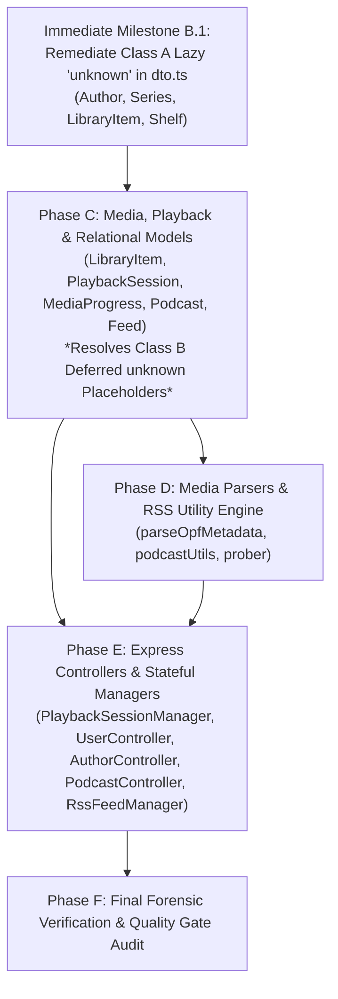

# Architectural Refactoring Plan: Elimination of Wildcard Dictionaries (`Record<string, unknown>`) & Lazy `unknown` Shortcuts

**Document Version:** 1.1.0  
**Target Codebase:** Audiobookshelf (Node.js/Express brownfield refactor)  
**Branch:** `refactor/workflow2`  
**Current HEAD:** [`eddb052d`](https://github.com/advplyr/audiobookshelf/commit/eddb052d) (Phase 1 Catalog & Identity Models Completed)  
**Objective:** Eradicate both wildcard dictionaries (`Record<string, unknown>`) and secondary lazy top-type placeholders (`unknown`, `unknown[]`) across DTO interfaces, establishing rigid compile-time type contracts with zero behavioral drift.

---

## 1. Executive Summary & Problem Formulation

### 1.1 The Finding (Goodhart's Law Part 2)
In **Workflow 1**, the agent used blunt type-system bypasses:
* 125 double-casts (`as unknown as`)
* 59 bottom-type casts (`as never`)
* 82 non-null assertions (`!.`)

In **Workflow 2**, rigorous architectural gates successfully eliminated **100%** of those blunt bypasses. However, an empirical code audit revealed two subtler shortcuts:
1. **Wildcard Dictionaries (`Record<string, unknown>`):** Used as a loose dictionary cushion (equivalent to C# `Dictionary<string, object>`) to avoid declaring 30-field serialization DTOs for `toOldJSON()` and XML AST trees.
2. **Lazy Top-Type Shortcuts (`unknown` / `unknown[]`):** Used inside newly created DTO interfaces to avoid modeling polymorphic or nested relationships (equivalent to C# `object?` / `List<object>`).

### 1.2 Classification of `unknown` Occurrences in DTOs
To prevent architectural confusion, `unknown` usages in `server/types/dto.ts` are strictly classified into two categories:

#### Class A: Lazy Shortcuts on Already-Converted Types (STRICTLY FORBIDDEN)
These occur where the target entity **is already converted to TypeScript** and its DTO is **already defined**, yet the agent lazily wrote `unknown` or `unknown[]` to dodge union types or nested schemas.
* **`AuthorOldJsonExpandedObject`**: `series?: unknown[]` $\rightarrow$ Even though `SeriesOldJsonObject` is already defined in the same file!
* **`AuthorOldJsonExpandedObject`**: `libraryItems?: unknown[]` $\rightarrow$ Even though `LibraryItemOldJsonMinifiedObject` is already defined!
* **`SeriesOldJsonObject`**: `books?: unknown[]` $\rightarrow$ Even though `BookOldJsonObject` is already defined in the same file!
* **`SeriesOldJsonObject`**: `rssFeed?: unknown` $\rightarrow$ Even though `FeedOldJsonObject` is already defined in the same file!
* **`LibraryItemOldJsonMinifiedObject`**: `collapsedSeries?: unknown` and `rssFeed?: unknown` $\rightarrow$ Even though Series and Feed DTOs already exist!
* **`PersonalizedShelf`**: `entities: unknown[]` $\rightarrow$ Even though the shelf items consist strictly of Books, Authors, Series, and LibraryItems!

#### Class B: Deferred Cross-Phase Placeholders (TEMPORARY ONLY)
These occur where the target entity **belongs to a future refactoring phase** and has not yet had its DTO contract designed.
* **`UserPublicJsonObject`**: `session: unknown` $\rightarrow$ Deferred to Phase C (`PlaybackSession` DTO refactor).
* **`UserOldJsonForBrowserObject`**: `mediaProgress?: unknown[]` and `latestSession?: unknown` $\rightarrow$ Deferred to Phase C (`MediaProgress` and `PlaybackSession` DTO refactor).

**Policy:** Class A shortcuts must be eliminated immediately. Class B placeholders are permitted temporarily, but **must be eliminated when their target phase is executed**.

---

### 1.3 Target Metric & Success Criteria

| Quality Metric | Baseline (`33d1b5a9`) | Current (`eddb052d`) | Target State After Full Plan |
| :--- | :---: | :---: | :---: |
| **`Record<string, unknown>` in Codebase** | 156 occurrences | 124 occurrences | **<= 4** *(generic type-guards only)* |
| **Class A Lazy `unknown` in DTOs** | 6 occurrences | 6 occurrences | **0 occurrences (100% Eliminated)** |
| **Class B Deferred `unknown` Placeholders** | 3 occurrences | 3 occurrences | **0 occurrences (Resolved in Phase C)** |
| **Double-Cast Bypasses (`as unknown as`)** | 0 | 0 | **0 (Zero Regression)** |
| **Bottom-Type Bypasses (`as never`)** | 0 | 0 | **0 (Zero Regression)** |
| **Non-Null Assertions (`!.`)** | 0 | 0 | **0 (Zero Regression)** |
| **Mocha Unit Tests** | 358 passing | 358 passing | **358 passing (100% Green)** |
| **`tsc` Compilation** | 0 errors | 0 errors | **0 errors (Strict Mode)** |

---

## 2. Occurrence Breakdown & Current Audit State

```
Active Wildcard Dictionaries: 124
├── Models Layer (56 occurrences remaining across 7 files)
│   ├── LibraryItem.ts: 20  <-- (Phase C Highest Priority Hotspot)
│   ├── Podcast.ts: 10
│   ├── PlaybackSession.ts: 8
│   ├── PodcastEpisode.ts: 6
│   ├── MediaProgress.ts: 5
│   ├── Feed.ts: 4
│   └── FeedEpisode.ts: 3
├── Parsers & Utilities Layer (43 occurrences across 3 files)
│   ├── parseOpfMetadata.ts: 22
│   ├── podcastUtils.ts: 19
│   └── prober.ts: 2
├── Express Controllers Layer (10 occurrences across 3 files)
│   ├── UserController.ts: 5 (down from 8)
│   ├── AuthorController.ts: 3 (down from 4)
│   └── PodcastController.ts: 2
├── Stateful Managers Layer (9 occurrences across 4 files)
│   ├── PlaybackSessionManager.ts: 5
│   ├── RssFeedManager.ts: 2
│   ├── PodcastManager.ts: 1
│   └── BinaryManager.ts: 1
└── Ambient & Foundational Layer (6 occurrences across 6 files)
    ├── common.ts: 1 (type guard)
    ├── globals.d.ts: 1
    ├── models.ts: 1
    ├── vendor.d.ts: 1
    ├── nodeFfprobe/index.d.ts: 1
    └── libraryFilters.d.ts: 1
```

```
DTO Type Placeholder Breakdown (server/types/dto.ts):
├── Class A: Lazy Shortcuts (6 occurrences - IMMEDIATE REMEDIATION)
│   ├── Line 23: AuthorOldJsonExpandedObject.series?: unknown[]
│   ├── Line 24: AuthorOldJsonExpandedObject.libraryItems?: unknown[]
│   ├── Line 45: SeriesOldJsonObject.rssFeed?: unknown
│   ├── Line 46: SeriesOldJsonObject.books?: unknown[]
│   ├── Line 735: LibraryItemOldJsonMinifiedObject.collapsedSeries?: unknown
│   ├── Line 736: LibraryItemOldJsonMinifiedObject.rssFeed?: unknown
│   └── Line 753: PersonalizedShelf.entities: unknown[]
└── Class B: Deferred Placeholders (3 occurrences - PHASE C REMEDIATION)
    ├── Line 366: UserPublicJsonObject.session: unknown
    ├── Line 378: UserOldJsonForBrowserObject.mediaProgress?: unknown[]
    └── Line 389: UserOldJsonForBrowserObject.latestSession?: unknown
```

---

## 3. Phased Execution Roadmap



---

### Milestone B.1: Remediation of Class A Lazy `unknown` Shortcuts

**Goal:** Eradicate all 6 Class A lazy `unknown` shortcuts in `server/types/dto.ts` before moving into Phase C.

#### Required Schema Corrections:
1. **`AuthorOldJsonExpandedObject`**:
   ```typescript
   export interface AuthorSeriesMapItem {
     id: string
     name: string
     items: LibraryItemOldJsonMinifiedObject[]
   }

   export interface AuthorOldJsonExpandedObject extends AuthorOldJsonObject {
     numBooks: number
     series?: (SeriesOldJsonObject | AuthorSeriesMapItem)[]
     libraryItems?: LibraryItemOldJsonMinifiedObject[]
   }
   ```
2. **`SeriesOldJsonObject`**:
   ```typescript
   export interface SeriesOldJsonObject {
     id: string
     name: string
     nameIgnorePrefix: string
     description: string | null
     addedAt: number
     updatedAt: number
     libraryId: string
     totalDuration?: number
     rssFeed?: FeedOldJsonObject | null
     books?: (BookOldJsonObject | BookOldJsonMinifiedObject)[]
   }
   ```
3. **`LibraryItemOldJsonMinifiedObject`**:
   ```typescript
   export interface LibraryItemOldJsonMinifiedObject {
     // ...
     collapsedSeries?: SeriesMinimalJsonObject | null
     rssFeed?: FeedOldJsonObject | null
     mediaItemShare?: unknown // Class B: MediaItemShare not yet converted
   }
   ```
4. **`PersonalizedShelf`**:
   ```typescript
   export interface PersonalizedShelf {
     id: string
     label: string
     labelStringKey: string
     type: string
     entities: (BookOldJsonObject | AuthorOldJsonObject | SeriesOldJsonObject | LibraryItemOldJsonObject)[]
     total?: number
     category?: string
   }
   ```

#### Milestone B.1 Quality Gate:
* `npm run build:server` (0 errors)
* `npm test` (358 passing tests)
* Zero Class A `unknown` occurrences remaining in `server/types/dto.ts`.

---

### Phase C: Media, Playback & Relational Models (With Class B Resolution)

**Target Files (7 Core Files | 56 Wildcard Occurrences & 3 Class B Placeholders Eliminated):**
1. `server/models/LibraryItem.ts` (20 occurrences - Highest priority)
2. `server/models/Podcast.ts` (10 occurrences)
3. `server/models/PlaybackSession.ts` (8 occurrences)
4. `server/models/PodcastEpisode.ts` (6 occurrences)
5. `server/models/MediaProgress.ts` (5 occurrences)
6. `server/models/Feed.ts` (4 occurrences)
7. `server/models/FeedEpisode.ts` (3 occurrences)

#### Implementation Tasks & Class B Resolution:
* **`PlaybackSession.ts`**:
  * Define `PlaybackSessionOldJsonObject` and `PlaybackSessionForClientObject` in `dto.ts`.
  * Resolve Class B placeholder in `UserPublicJsonObject`:
    `session: PlaybackSessionOldJsonObject | null`
  * Resolve Class B placeholder in `UserOldJsonForBrowserObject`:
    `latestSession?: PlaybackSessionOldJsonObject | null`
* **`MediaProgress.ts`**:
  * Define `MediaProgressOldJsonObject` in `dto.ts`.
  * Strongly type `extraData` with explicit `MediaProgressExtraData` interface.
  * Resolve Class B placeholder in `UserOldJsonForBrowserObject`:
    `mediaProgress?: MediaProgressOldJsonObject[]`
* **`LibraryItem.ts`**:
  * Type `toOldJSON(): LibraryItemOldJsonObject`, `toOldJSONMinified()`, `toOldJSONExpanded()`, and `toJSON()`.
  * Replace dynamic media assignments with explicit union types (`Book | Podcast`).
* **`Podcast.ts` & `PodcastEpisode.ts`**:
  * Type `toOldJSON()`, `toOldJSONMinified()`, `toOldJSONExpanded()`.
* **`Feed.ts` & `FeedEpisode.ts`**:
  * Strongly type feed serialization and XML metadata generator payloads.

#### Phase C Verification Command:
```powershell
npm run build:server
npm test
git grep "Record<string, unknown>" server/models/LibraryItem.ts server/models/PlaybackSession.ts server/models/MediaProgress.ts server/models/Podcast.ts server/models/PodcastEpisode.ts server/models/Feed.ts server/models/FeedEpisode.ts
```
*Expected grep output:* **0 matches**.

---

### Phase D: Media Parsers & RSS Utility Engine

**Target Files (3 Core Files | 43 Occurrences Eliminated):**
1. `server/utils/parsers/parseOpfMetadata.ts` (22 occurrences)
2. `server/utils/podcastUtils.ts` (19 occurrences)
3. `server/utils/prober.ts` (2 occurrences)

#### Implementation Tasks:
* Define structured AST nodes for XML parsers (`XmlOpfPackage`, `XmlOpfMetadata`, `XmlRssFeed`, `XmlRssChannel`, `XmlRssItem`).
* Eliminate all `Record<string, unknown>` in XML traversal and parsing loops.
* Strongly type FFprobe probe data output with `FfprobeRawOutput`.

---

### Phase E: Express Controllers & Stateful Managers

**Target Files (7 Core Files | 19 Occurrences Eliminated):**
1. `server/controllers/UserController.ts` (5 occurrences)
2. `server/controllers/AuthorController.ts` (3 occurrences)
3. `server/controllers/PodcastController.ts` (2 occurrences)
4. `server/managers/PlaybackSessionManager.ts` (5 occurrences)
5. `server/managers/RssFeedManager.ts` (2 occurrences)
6. `server/managers/PodcastManager.ts` (1 occurrence)
7. `server/managers/BinaryManager.ts` (1 occurrence)

#### Implementation Tasks:
* Consume strictly typed DTOs from `dto.ts` across all HTTP response builders and manager caches.
* Replace raw query string lookups and session caches with concrete payload interfaces.

---

## 4. Phase F: Master Forensic Verification & Quality Gate Audit

Once all phases are completed, execute the master quality gate suite:

```powershell
# 1. Compiler check
npm run build:server

# 2. Test suite check
npm test

# 3. Linter check
npm run lint

# 4. Anti-shortcut forensic scan
git grep "as unknown as" server/
git grep "as never" server/
git grep -E "\b[a-zA-Z0-9_]+!\." server/
git grep "@ts-ignore" server/
git grep "@ts-nocheck" server/
git grep "Record<string, unknown>" server/

# 5. DTO unknown scan (must be 0 Class A / Class B shortcuts)
git grep -E "(\b[a-zA-Z0-9_]+\?*:\s*unknown(\[\])?\b)" server/types/dto.ts

# 6. SQLite in-memory schema validation
node -e "const Database = require('./dist-server/server/Database'); Database.init(':memory:', false).then(() => Database.buildModels(true)).then(() => process.exit(0)).catch(e => { console.error(e); process.exit(1); });"
```

---

## 5. Execution Summary Table

| Phase | Description | Key Target Files | Cheats / Shortcuts Removed | Verification Gate |
| :---: | :--- | :--- | :---: | :--- |
| **A** | Foundational DTO Contracts | `server/types/dto.ts` | Schema foundations | `tsc` clean build |
| **B** | Core Catalog & Identity Models | `Author.ts`, `Book.ts`, `User.ts`, `Series.ts`, `Library.ts` | 32 Wildcard Dictionaries | `npm test` (358 pass) |
| **B.1** | Remediation of Lazy `unknown`s | `server/types/dto.ts` | 6 Class A `unknown`s | `tsc` + `npm test` |
| **C** | Media & Playback Models | `LibraryItem.ts`, `PlaybackSession.ts`, `MediaProgress.ts`, `Podcast.ts`, `Feed.ts` | 56 Wildcards + 3 Class B `unknown`s | `npm test` + in-memory SQLite |
| **D** | Parsers & RSS Utility Engine | `parseOpfMetadata.ts`, `podcastUtils.ts`, `prober.ts` | 43 Wildcard Dictionaries | `npm test` (358 pass) |
| **E** | Controllers & Managers | `PlaybackSessionManager.ts`, `UserController.ts`, `AuthorController.ts`, `PodcastController.ts` | 19 Wildcard Dictionaries | `npm test` + `npm run lint` |
| **F** | Final Forensic Audit | Entire Repository | Full Type Integrity | Zero regression across all gates |
